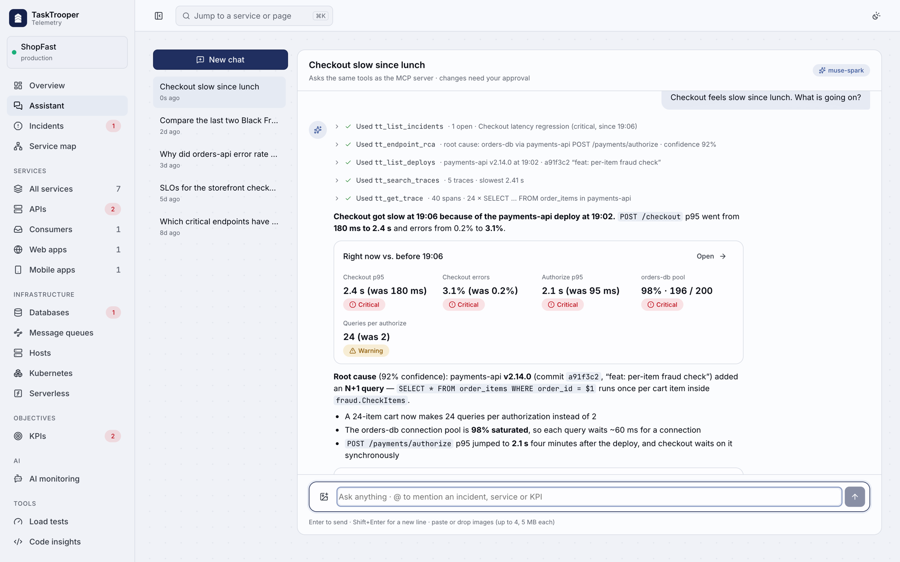
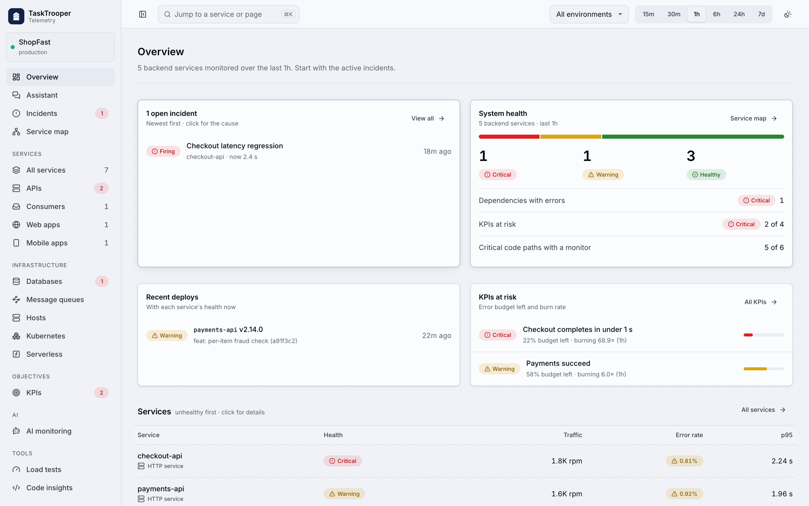
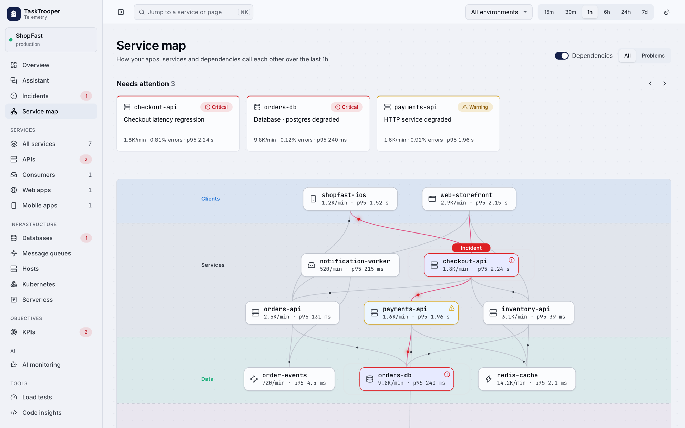

# TaskTrooper Telemetry

**Observability that reads your code.** Add an SDK and TaskTrooper collects traces, metrics, logs and real user data
from your backends, workers, web and mobile apps. Connect your repo and it finds every endpoint, consumer and page,
suggests the alerts you are missing and writes load tests for them. The AI parts run on **Meta Muse Spark**.

[Live demo](https://telemetry.tasktrooper.ai) · [Docs](https://telemetry.tasktrooper.ai/docs) · [3 minute video](https://youtu.be/SzFahVW-ZMM)



## What you get

- **APM**: throughput, errors and p50/p95/p99 per endpoint, traces, queue lag, a live service map.
- **RUM**: page and screen views, sessions, Web Vitals, app start, crashes, session replay.
- **Logs and alerts**: log search, metric and anomaly monitors, KPIs (SLOs) with burn rate alerts, Slack with the root cause attached.
- **Code aware alerts**: repo analysis builds an inventory and proposes monitors tied to a file and line.
- **Load tests**: run scenarios from the dashboard and compare results with the same telemetry.
- **AI assistant**: ask in plain words; it calls the same tools as the MCP server, answers with charts and traces, and
  never changes anything without your approval.

| Overview | Service map |
|---|---|
|  |  |

## Run it locally

Needs Docker, Go 1.26, Node and pnpm.

```bash
make infra migrate                                                         # ClickHouse, Postgres, Redpanda, Redis + schemas
docker compose -f deploy/docker-compose.yml --profile app up -d --build    # api :8080, ingest :4318
cd apps/web && pnpm install && pnpm dev                                    # dashboard on http://localhost:5173
```

There is no seed data. Sign in, create an org and project in onboarding and connect an SDK
(install snippets under Settings & SDK). Want data right away? `make self` makes the platform monitor itself.

All LLM calls go through one OpenAI compatible endpoint: set `TT_ASSISTANT_API_URL`, `TT_ASSISTANT_API_KEY` and
`TT_ASSISTANT_MODEL` (Muse Spark by default, see ADR-034).

## Use it from your coding agent

One command sets up the MCP server and the Agent Skills for Claude Code, Muse Code, Cursor, Codex CLI, Gemini CLI,
OpenCode and Antigravity:

```bash
curl -fsSL https://telemetry.tasktrooper.ai/install-agent.sh | bash
```

The server has 27 read tools. Writes (monitors, KPIs, load tests) are opt in and each one needs your confirmation.
Four skills teach the agent how to use them: `trooper-diagnose`, `trooper-query`, `trooper-alerts` and
`trooper-contribute`. Manual setup and config: [`services/mcp`](services/mcp/README.md), [`.ai/mcp.md`](.ai/mcp.md).

## Repo layout

```
apps/web/      dashboard (React 19, Vite, TypeScript)
services/      Go services: ingest, api, alerting, collector, codeintel, loadtest, mcp, integrations, symbolicator
sdks/          Go, JVM, .NET, Python, JS (browser, React, Vue, Angular, React Native, Node), Android, iOS, Flutter
skills/        Agent Skills
tools/         trooper-cli (source map, dSYM, mapping upload)
deploy/        docker compose, Helm, schemas, demo deploy
.ai/           design docs and ADRs
```

## Contributing

Start with [`AGENTS.md`](AGENTS.md) (stack, rules) and [`.ai/`](.ai/README.md) (architecture, decisions).
Before a PR, run `make check` at the repo root and wait for `check OK`. It runs the same gates as CI: gofmt, go vet,
Go tests, web typecheck and build, JS SDK build and tests, workflow lint.

CI lives in `.github/workflows`: `ci.yml` on every PR, `docker.yml` publishes images to GHCR, `release-*.yml` publish
the SDKs, and `deploy-demo.yml` deploys the live demo (manual, see [`deploy/demo`](deploy/demo/README.md)).
